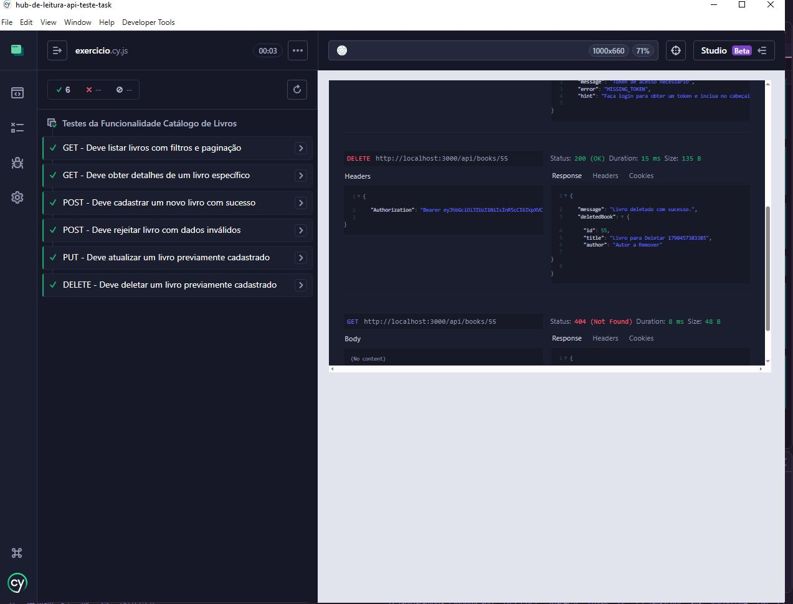

# 📚 Hub de Leitura - API Teste Task

Projeto de testes automatizados com Cypress para a API do Catálogo de Livros. Este projeto foi desenvolvido como exercício prático para testar uma API REST de gerenciamento de livros.

## 📋 Pré-requisitos

- Node.js (v14 ou superior)
- npm ou yarn
- Git

## 🚀 Como Baixar o Projeto

```bash
git clone https://github.com/EBAC-QE/hub-de-leitura-api-teste-task.git
cd hub-de-leitura-api-teste-task
```

## 📦 Instalação

Após clonar o repositório, instale as dependências do projeto:

```bash
npm install
```

Isso instalará o Cypress e todas as dependências necessárias definidas no `package.json`.

## 🏗️ Estrutura do Projeto

```
.
├── cypress/
│   ├── e2e/
│   │   ├── exercicio.cy.js      # Arquivo com os testes a serem implementados
│   │   └── usuarios.cy.js       # Exemplo de testes de usuários
│   ├── fixtures/
│   │   └── example.json         # Dados de teste (fixtures)
│   └── support/
│       ├── commands.js          # Comandos customizados do Cypress
│       └── e2e.js              # Configurações de suporte
├── cypress.config.js            # Configuração do Cypress
├── package.json                 # Dependências do projeto
└── README.md                    # Este arquivo
```

## 📝 Como Executar os Testes

### Executar todos os testes (modo headless)

```bash
npm test
```

### Executar testes com a interface do Cypress (modo interativo)

```bash
npm run cypress:open
```

Isso abrirá a interface do Cypress onde você pode:
- Visualizar os testes
- Executá-los interativamente
- Depurar erros em tempo real
- Ver o comportamento da aplicação

### Executar um arquivo de teste específico

```bash
npx cypress run --spec "cypress/e2e/exercicio.cy.js"
```

## ✏️ Como Fazer o Exercício

O arquivo [cypress/e2e/exercicio.cy.js](cypress/e2e/exercicio.cy.js) contém 6 testes para a API de Catálogo de Livros que precisam ser implementados:

### 1️⃣ **GET - Deve listar livros com filtros e paginação**
- **Objetivo:** Verificar que a API retorna lista de livros com filtros por categoria e autores funcionando
- **O que fazer:** Fazer uma requisição GET para `/api/books` com parâmetros de filtro
- **Validações:** Verificar status 200, estrutura de resposta, paginação funcionando

### 2️⃣ **GET - Deve obter detalhes de um livro específico**
- **Objetivo:** Validar que é possível obter detalhes de um livro específico pelo ID
- **O que fazer:** Fazer uma requisição GET para `/api/books/{id}` com um ID válido
- **Validações:** Verificar status 200, todos os campos do livro retornados

### 3️⃣ **POST - Deve cadastrar um novo livro com sucesso**
- **Objetivo:** Validar que um novo livro é adicionado com sucesso ao catálogo
- **O que fazer:** Fazer uma requisição POST para `/api/books` com dados válidos do livro
- **Validações:** Verificar status 201, livro criado com ID, apenas admin pode criar

### 4️⃣ **POST - Deve rejeitar livro com dados inválidos**
- **Objetivo:** Garantir que dados inválidos são rejeitados
- **O que fazer:** Fazer uma requisição POST para `/api/books` com dados faltantes ou incorretos
- **Validações:** Verificar status 400 ou erro apropriado, mensagem de erro clara

### 5️⃣ **PUT - Deve atualizar um livro previamente cadastrado**
- **Objetivo:** Validar que um livro pode ser atualizado com sucesso
- **O que fazer:** Fazer uma requisição PUT para `/api/books/{id}` com novos dados
- **Validações:** Verificar status 200, livro atualizado corretamente, apenas admin pode editar

### 6️⃣ **DELETE - Deve deletar um livro previamente cadastrado**
- **Objetivo:** Validar que um livro pode ser removido do catálogo
- **O que fazer:** Fazer uma requisição DELETE para `/api/books/{id}`
- **Validações:** Verificar status 200, livro removido, apenas admin pode deletar

## 🔑 Autenticação

O projeto já possui um comando customizado `cy.geraToken()` que gera um token JWT para autenticação. 

No seu teste, use:

```javascript
let token
beforeEach(() => {
    cy.geraToken('admin@biblioteca.com', 'admin123').then(tkn => {
        token = tkn
    })
});
```

Isso obterá um token que pode ser usado nas requisições que exigem autenticação (POST, PUT, DELETE).

## 📚 Endpoints da API

| Método | Endpoint | Descrição |
|--------|----------|-----------|
| GET | `/api/books` | Listar livros com filtros e paginação |
| GET | `/api/books/{id}` | Obter detalhes de um livro |
| POST | `/api/books` | Criar novo livro (Admin) |
| PUT | `/api/books/{id}` | Atualizar livro (Admin) |
| DELETE | `/api/books/{id}` | Deletar livro (Admin) |
| GET | `/api/books/categories` | Listar categorias |
| GET | `/api/books/authors` | Listar autores |

## 💡 Dicas para Implementar os Testes

1. **Use `cy.request()`** para fazer requisições HTTP
2. **Use `.should()`** para validações
3. **Use `cy.intercept()`** para mockar respostas se necessário
4. **Estruture seus dados** em fixtures para melhor organização
5. **Use `beforeEach()`** para setup comum entre testes
6. **Valide status code, headers e body** das respostas

## 🐛 Troubleshooting

- **Testes falhando por autenticação?** Verifique se o comando `cy.geraToken()` está funcionando
- **Erro de conexão?** Certifique-se de que o servidor da API está rodando
- **Imports não encontrados?** Execute `npm install` novamente

## 📖 Documentação Útil

- [Cypress Official Docs](https://docs.cypress.io/)
- [Cypress cy.request()](https://docs.cypress.io/api/commands/request)
- [Testing REST APIs](https://docs.cypress.io/guides/end-to-end-testing/testing-your-app)

## 👨‍💻 Autor

Desenvolvido como exercício prático de testes de API com Cypress.

## ✅ Evidência de execução

Os 6 cenários de `exercicio.cy.js` passando no Cypress, cobrindo GET (com filtros e paginação, e por ID), POST (sucesso e rejeição de dados inválidos), PUT e DELETE — incluindo a validação de que as rotas protegidas exigem token de administrador:



---

**Boa sorte com os testes! 🚀**
